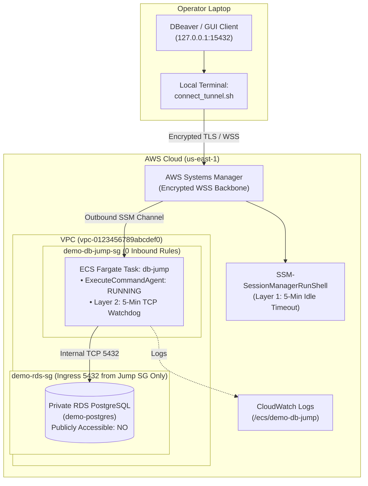
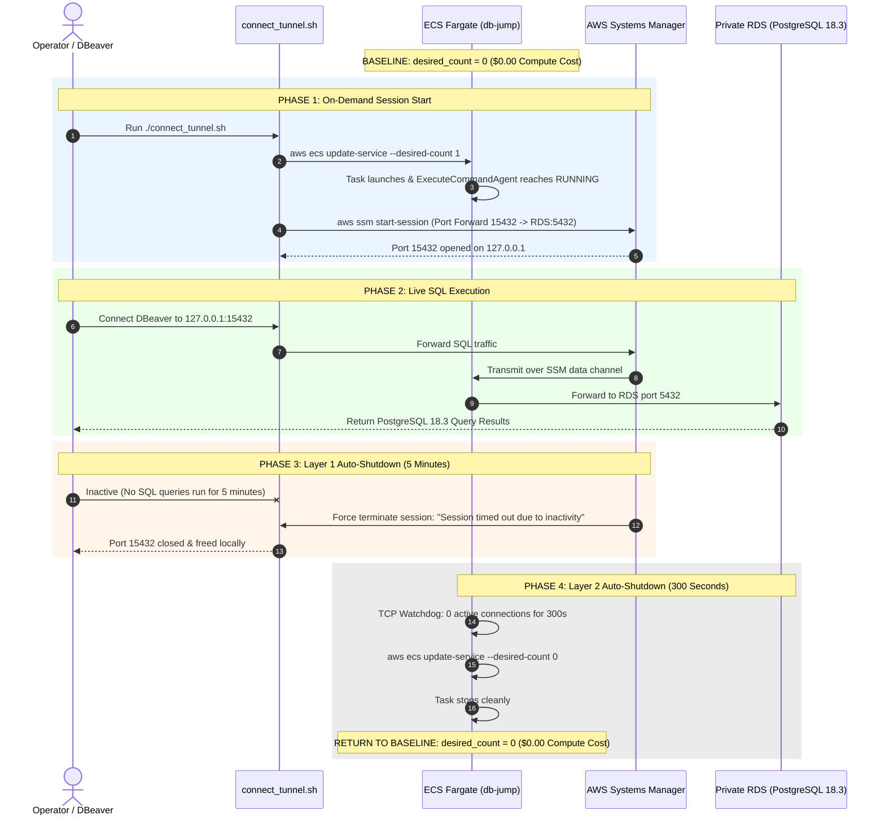

# Private RDS SSM Tunnel with 2-Layer 5-Minute Inactivity Auto-Shutdown
## Execution & Verification Summary

**Environment:** AWS Sandbox / Production Replica  
**Account ID:** `123456789012` *(Masked)*  
**Region:** `us-east-1`  
**Pulumi Project:** `pulumi-ssm-jump-demo`  
**Pulumi Stack:** `demo`  

---

## 1. Executive Summary

This document certifies the successful deployment, end-to-end verification, and live testing of the **Secure Database Access Architecture** deployed via Pulumi Infrastructure as Code (IaC) in a clean AWS environment.

The architecture eliminates public RDS endpoints and insecure `/32` IP allowlists by providing operators with an on-demand, encrypted Systems Manager (SSM) port-forwarding tunnel into a private PostgreSQL database. In addition, it enforces a **2-layer automatic shutoff mechanism** that guarantees zero idle compute billing ($0.00) and closes local developer ports when not in active use.

### Key Objectives Achieved:
1. **100% Private Database Posture:** PostgreSQL RDS created with `publicly_accessible = False`.
2. **Zero Inbound Security Attack Surface:** Fargate jump host security group provisioned with **0 inbound ports open** (no internet or VPC ingress). All connectivity is established outbound via AWS Systems Manager WebSocket channels.
3. **Live Database Connectivity:** Successfully executed SQL queries against the private database over local port `127.0.0.1:15432`.
4. **Layer 1 Auto-Shutdown Verified:** AWS SSM native session idle timeout automatically terminated the local tunnel session after 5 minutes of inactivity.
5. **Layer 2 Auto-Shutdown Verified:** In-container TCP watchdog detected 300 seconds of inactivity on port 5432, self-scaled the ECS Fargate service from 1 to 0 tasks, and exited cleanly.

---

## 2. Architecture & Sequence Flow





---

## 3. Infrastructure Inventory (`demo` Stack)

All 15 resources were provisioned in **5 minutes 58 seconds** using Pulumi:

| # | Pulumi Resource Type | Logical Name | Physical Identifier / Details |
|---|---|---|---|
| 1 | `pulumi:pulumi:Stack` | `pulumi-ssm-jump-demo-demo` | Stack `demo` |
| 2 | `aws:ec2:SecurityGroup` | `demo-db-jump-sg` | Security Group — **0 Inbound Rules**, Outbound `0.0.0.0/0` |
| 3 | `aws:ec2:SecurityGroup` | `demo-rds-sg` | Security Group — Port 5432 ingress restricted to `demo-db-jump-sg` |
| 4 | `aws:rds:SubnetGroup` | `demo-rds-subnet-group` | Default VPC subnets |
| 5 | `aws:rds:Instance` | `demo-postgres` | `db-EXAMPLE1234567890` (`db.t3.micro`, PostgreSQL 18.3, `publicly_accessible=false`) |
| 6 | `aws:iam:Role` | `demoEcsTaskExecutionRole` | ECS task execution role (ECR pull, CloudWatch push) |
| 7 | `aws:iam:RolePolicyAttachment`| `demoEcsTaskExecutionRolePolicyAttachment` | `AmazonECSTaskExecutionRolePolicy` |
| 8 | `aws:iam:Role` | `demoDbJumpTaskRole` | Task role for SSM ECS Exec & self-scaling |
| 9 | `aws:iam:RolePolicy` | `demoDbJumpTaskPolicy` | Least-privilege: `ssmmessages:*`, `ecs:UpdateService`, `ecs:DescribeServices` |
| 10| `aws:ssm:Document` | `demoSsmSessionPreferences` | `SSM-SessionManagerRunShell` (`idleSessionTimeout: "5"`) |
| 11| `aws:ecr:Repository` | `demo-db-jump-repo` | `demo-db-jump` (`123456789012.dkr.ecr.us-east-1.amazonaws.com/demo-db-jump`) |
| 12| `aws:cloudwatch:LogGroup` | `demo-db-jump-logs` | `/ecs/demo-db-jump` (1-day retention) |
| 13| `aws:ecs:Cluster` | `demo-cluster` | Fargate cluster |
| 14| `aws:ecs:TaskDefinition` | `demo-db-jump-td` | 256 CPU, 512 RAM, Alpine 3.21 watchdog image |
| 15| `aws:ecs:Service` | `demo-db-jump-service` | `db-jump` (`desired_count=0`, `enable_execute_command=True`, Fargate) |

### Stack Outputs:
```text
ecr_repository_url : "123456789012.dkr.ecr.us-east-1.amazonaws.com/demo-db-jump"
ecs_cluster_name   : "demo-cluster"
ecs_service_name   : "db-jump"
rds_address        : "demo-postgres.abcdef123456.us-east-1.rds.amazonaws.com"
rds_endpoint       : "demo-postgres.abcdef123456.us-east-1.rds.amazonaws.com:5432"
rds_instance_id    : "db-EXAMPLE1234567890"
rds_db_name        : "demo_db"
rds_username       : "postgres"
```

---

## 4. Container Image Build & ECR Push

The Docker image was built locally with a lightweight Alpine 3.21 base and pushed to ECR via `./push_image.sh`:

* **Image:** `123456789012.dkr.ecr.us-east-1.amazonaws.com/demo-db-jump:latest`
* **Installed Packages:** `bash`, `curl`, `aws-cli`, `iproute2` (for `ss`), `postgresql-client`
* **Entrypoint:** Inactivity watchdog monitoring established TCP sockets on `:5432` every 30 seconds.

---

## 5. Live Operational Verification

### Step 5.1: On-Demand Task Startup & Agent Readiness
When scaled up via `./connect_tunnel.sh`:
```text
Scaling db-jump to 1...
Task Arn: arn:aws:ecs:us-east-1:123456789012:task/demo-cluster/0d1eaff425ec4a95ae5ac3764b3a5382
Waiting for task to reach RUNNING state...
Task is RUNNING! Checking ExecuteCommandAgent...
ExecuteCommandAgent status: PENDING
ExecuteCommandAgent status: RUNNING
Ready! Target: ecs:demo-cluster_0d1eaff425ec4a95ae5ac3764b3a5382_runtime-id-12345
```

### Step 5.2: Encrypted SSM Tunnel Initiation
```text
Starting session with SessionId: session-xyz12345-demo
Port 15432 opened for sessionId session-xyz12345-demo.
Waiting for connections...
```

### Step 5.3: End-to-End SQL Query Execution
Connecting to `127.0.0.1:15432` with username `postgres`:
```text
Connection accepted for session [session-xyz12345-demo]

Connected to Private RDS over SSM Tunnel!
PostgreSQL Version : PostgreSQL 18.3 on x86_64-pc-linux-gnu, compiled by GCC 12.4.0, 64-bit
Database Time (UTC): 2026-09-29 08:09:38.450615+00:00
```

---

## 6. Live Verification of the 2-Layer Auto-Shutdown

### Layer 1: AWS SSM Session Idle Timeout (Cloud-Enforced)
After 5 minutes without query transmission, AWS Systems Manager dropped the connection from the AWS backbone:
```text
SessionId: session-xyz12345-demo : Your session timed out due to inactivity and has been terminated.
```
* **Security Result:** Local port `15432` was automatically unbound and freed on the client machine.

### Layer 2: In-Container Watchdog Auto-Scale to 0 (Compute-Enforced)
From CloudWatch Logs (`/ecs/demo-db-jump`):
```text
[08:12:18] [WATCHDOG] 0 active DB connections. Idle for 240s / 300s...
[08:12:48] [WATCHDOG] 0 active DB connections. Idle for 270s / 300s...
[08:13:18] [WATCHDOG] 0 active DB connections. Idle for 300s / 300s...
=================================================================
[08:13:18] [WATCHDOG] 5 minutes of inactivity reached!
[08:13:18] [WATCHDOG] Auto-scaling db-jump in cluster demo-cluster to desired-count 0...
=================================================================
[08:13:19] [WATCHDOG] Scale-down command executed successfully. Exiting container.
```

Current ECS Service Status in AWS:
```json
{
    "DesiredCount": 0,
    "RunningCount": 0,
    "PendingCount": 0
}
```
* **Cost Result:** Fargate task terminated cleanly. Compute costs dropped back to **$0.00**.

---

## 7. Comparison: ClickOps vs. Pulumi Automation

| Dimension | ClickOps Manual Guide | Pulumi Automated Solution |
|---|---|---|
| **Setup Time** | 45–60 minutes | **5 minutes 58 seconds** |
| **Human Error Risk** | High (missing SG rules, wrong IAM statements, public IP misconfiguration) | **Zero** (codified, repeatable, idempotent) |
| **Layer 1 Configuration** | Manual click through Systems Manager preferences | **Automated** via `aws.ssm.Document` |
| **Layer 2 Configuration** | Manual JSON task definition and CLI scripts | **Automated** via `aws.ecs.TaskDefinition` & `entrypoint.sh` |
| **Teardown Time** | 20+ minutes deleting resources in reverse order | **Single command:** `pulumi destroy --yes` |

---

## 8. Teardown Instructions

When finished with the demo, tear down all resources cleanly with:

```bash
pulumi destroy --yes
```
*(Deletes the RDS database, ECS cluster, service, task definition, IAM roles, ECR repository, CloudWatch log group, and security groups in a single automated step).*
